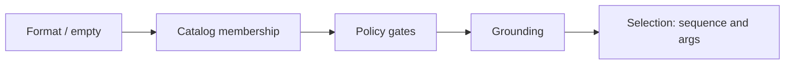
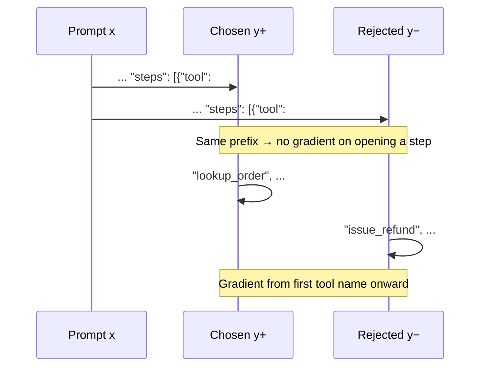
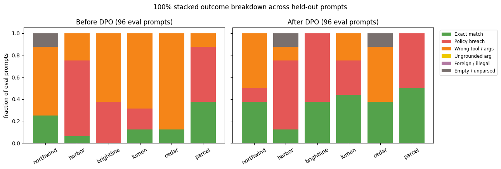

# DPO on enterprise tool plans: Experiment with DPO

## Preface: Why general-purpose LLMs do wasteful planning work, and how DPO + LoRA fixes it

### 1. The problem: How to customize General Purpose LLMs on grounded Tools in Enterprises

In a production AI agent, the **planning stage** sits between the user request and tool execution. It reads the enterprise tool catalog, company policy, and current observations, then outputs a structured plan (`{goal, steps, stop_when}`) without executing the tools itself.

General-purpose instruction-tuned LLMs are trained to be helpful and complete in a single conversational turn. When placed into a multi-step planning loop, that bias creates two expensive failure modes:

- **Wasteful work (`wrong_seq` — 53% of held-out prompts before tuning ):** The model schedules redundant or out-of-order steps instead of the minimal legal lookup—calling `check_coverage` and `file_claim` before `lookup_policy`, pairing `lookup_order` with `check_inventory`, or calling `ask_user` before `lookup_pnr` when the record id is already in the prompt. Every extra step burns latency, API budget, and context window.
- **Premature execution (`policy` — 29% before tuning):** When observations are empty, the model skips the lookup and fires high-stakes actions (`issue_refund`, `transfer`, `change_flight`, `reset_password`), or chains the lookup and the gated action in the same plan before seeing what the lookup returns.

### 2. What DPO (Direct Preference Optimization) is

Classical RLHF fixes bad generations by training a separate reward model and running online reinforcement learning (PPO/GRPO) over live sampled rollouts—an expensive pipeline to tune and maintain.

**Direct Preference Optimization (DPO)** eliminates both the separate reward model and the online rollout loop. Using a closed-form mapping between an optimal policy $\pi_\theta$ and its implicit reward relative to a frozen reference policy $\pi_{\mathrm{ref}}$, DPO turns alignment into a supervised binary cross-entropy loss over triples $(x, y^+, y^-)$:
- $x$: the planning prompt (tool catalog + policy rules + observations + user request)
- $y^+$ (`chosen`): the legal, minimal plan
- $y^-$ (`rejected`): a concrete near-miss plan for the same prompt

$$\mathcal{L}_{\text{DPO}}(\theta) = -\log \sigma\left(\beta\left[\log\frac{\pi_\theta(y^+|x)}{\pi_{\mathrm{ref}}(y^+|x)} - \log\frac{\pi_\theta(y^-|x)}{\pi_{\mathrm{ref}}(y^-|x)}\right]\right)$$

The term inside the brackets is the **implicit reward margin**: how much more probability mass $\pi_\theta$ assigns to the legal plan $y^+$ over the flawed plan $y^-$, compared with the starting model $\pi_{\mathrm{ref}}$. Because any shared prefix between $y^+$ and $y^-$ cancels out in the subtraction, DPO concentrates its gradient on the exact token where the good plan and the wasteful or illegal plan diverge.

### 3. LoRA connector
**LoRA (Low-Rank Adaptation)** freezes the base LLM (`Qwen/Qwen2.5-1.5B-Instruct`, 1,548,072,448 parameters) and attaches small trainable rank-16 matrices ($\alpha=32$) to the attention projections (`q_proj`, `k_proj`, `v_proj`, `o_proj`), updating **4,358,144 parameters (0.2815%)**.

In a DPO workflow, the LoRA connector provides two architectural advantages:
1. **No second model copy in GPU memory:** DPO needs log-probabilities from both $\pi_\theta$ and $\pi_{\mathrm{ref}}$ on every step. With `ref_model=None` in TRL, $\pi_{\mathrm{ref}}$ is computed by simply disabling the LoRA adapter on the same base weights in VRAM. Training 540 preference pairs for 2 epochs runs in **997 seconds (~16.6 minutes) on a single Colab T4 (14.6 GiB)** in native `float16`.
2. **Multi-tenant routing with a single base model:** Because the LoRA connector is a ~17 MB adapter on top of frozen weights and each company's tool catalog is passed in the prompt, one small base model can serve multiple enterprise domains (or swap domain-specific LoRA connectors on demand) without hosting separate full models.

### 4. How DPO improves agent planning here—and what the metrics actually mean
Instead of paying humans to label preference pairs, this lab pairs a **deterministic plan checker** (`format → empty → catalog → policy → grounding → selection`) with controlled failure mutations across six companies (540 train pairs, 96 held-out eval prompts). 

- **Cutting wasteful work works immediately:** Greedy held-out **wrong-tool / wasteful-sequence errors fell from 51/96 (0.53) to 22/96 (0.23)**, and **exact match more than doubled from 15/96 (0.16) to 35/96 (0.36)**. Twenty-two wrong-sequence prompts flipped directly into exact matches. **Ungrounded arguments stayed at 0%.**

The full method walkthrough is in [docs/blog.md](docs/blog.md). The sections below cover the checker order, the shared-prefix DPO trap, the lab setup, and the held-out transition matrix.

## Checker order

The checker labels one plan by the first rule it breaks. Two legal plans are not a preference pair. A plan that calls `issue_refund` before the order is in the observations fails policy, even when that plan is shorter than the lookup.

Policy gates: Northwind refunds only after observations show a delivered or returned order with `total_usd` <= 50. Harbor transfers or wires only when the observed balance covers the amount and the amount is <= 1000. Brightline changes a flight only when observations show a changeable fare, and refunds a ticket only when the fare is refundable. Lumen resets a password only for an employee whose identity is already verified. Cedar pays a claim only when coverage is confirmed and the amount is <= 1000. Parcel reroutes only while a shipment is in transit, and files damage only after delivery. When observations are empty, the legal plan is the lookup (or `ask_user` when the status is already a blocker).

## Shared prefix and what DPO actually trains

If chosen and rejected share tokens through the opening of `steps`, those tokens contribute zero to the DPO objective: identical prefix cancels in log π(y+|x) − log π(y−|x). Gradient concentrates on the first differing token and everything after.

## The lab

The model writes a plan; it does not run tools. Six fictious companies share the eval split: Northwind Retail, Harbor Bank, Brightline Air, Lumen IT, Cedar Insurance, ParcelPath. `enterprise_pairs.jsonl` has 636 rows (540 train, 96 eval), 90 train and 16 eval per company. Eval ids (Z910, ACCT-910, PNR-910, ivy@lumen.example, POL-910, SHP-910) never appear in train.

Train rejected-plan mutation counts: policy_breach 43, wrong_tool 85, foreign_tool 94, extra_tool 87, invented_arg 89, empty_steps 86, unnecessary_ask 56.

**Model and DPO**

- Base: `Qwen/Qwen2.5-1.5B-Instruct`
- LoRA r=16, alpha=32, dropout 0.05 on q/k/v/o_proj; `ref_model=None` (frozen base is reference)
- Trainable 4,358,144 / 1,548,072,448 params (0.2815%)
- DPO sigmoid, beta 0.1, lr 5e-5, 2 epochs, batch 2, grad accum 4, max_length 1024, max_prompt_length 768
- 136 steps, train_runtime 997.1 s, train_loss 0.0524
- Eval reward accuracy 1.000 at epoch 1 and 2; eval margin 11.417 then 12.149

Loss falls from about 0.58 to near 0 by step 40 and stays there; reward accuracy hits 1.0 by about step 10; margin climbs to about 12.

**Run:** Colab T4 → open `enterprise_tool_dpo.ipynb`. Pairs path: `enterprise_pairs.jsonl`.

**Generation eval:** greedy decode, max_new_tokens 180, batch 8, same 96 prompts before and after adapter load.

## Results

Held-out rates, before DPO (n=16 per company, 96 overall):

| company | n | exact | f1 | policy | wrong_seq | unground | illegal | empty |
|-------|---|-------|-----|--------|-----------|----------|---------|-------|
| northwind | 16 | 0.25 | 0.44 | 0.00 | 0.62 | 0.00 | 0.12 | 0.12 |
| harbor | 16 | 0.06 | 0.23 | 0.69 | 0.25 | 0.00 | 0.00 | 0.00 |
| brightline | 16 | 0.00 | 0.60 | 0.38 | 0.62 | 0.00 | 0.00 | 0.00 |
| lumen | 16 | 0.12 | 0.53 | 0.19 | 0.69 | 0.00 | 0.00 | 0.00 |
| cedar | 16 | 0.12 | 0.40 | 0.00 | 0.88 | 0.00 | 0.00 | 0.00 |
| parcel | 16 | 0.38 | 0.62 | 0.50 | 0.12 | 0.00 | 0.00 | 0.00 |
| OVERALL | 96 | 0.16 | 0.47 | 0.29 | 0.53 | 0.00 | 0.02 | 0.02 |

After DPO:

| company | n | exact | f1 | policy | wrong_seq | unground | illegal | empty |
|---------|---|-------|-----|--------|-----------|----------|---------|-------|
| northwind | 16 | 0.38 | 0.71 | 0.12 | 0.50 | 0.00 | 0.00 | 0.00 |
| harbor | 16 | 0.12 | 0.35 | 0.62 | 0.12 | 0.00 | 0.12 | 0.12 |
| brightline | 16 | 0.38 | 0.38 | 0.62 | 0.00 | 0.00 | 0.00 | 0.00 |
| lumen | 16 | 0.44 | 0.56 | 0.31 | 0.25 | 0.00 | 0.00 | 0.00 |
| cedar | 16 | 0.38 | 0.50 | 0.00 | 0.50 | 0.00 | 0.12 | 0.12 |
| parcel | 16 | 0.50 | 0.50 | 0.50 | 0.00 | 0.00 | 0.00 | 0.00 |
| OVERALL | 96 | 0.36 | 0.50 | 0.36 | 0.23 | 0.00 | 0.04 | 0.04 |

Prompt counts aligned with those rates: exact 15/96 before, 35/96 after; policy breaches 28/96 before, 35/96 after; wrong tool/args 51/96 before, 22/96 after; empty/unparsed 2/96 before (both Northwind, also in illegal), 4/96 after (Harbor 2, Cedar 2, also in illegal). Ungrounded stayed 0.

Reward accuracy saturates near step 10 while generation exact match on held-out prompts is still far from perfect.

Twenty-two wrong-tool prompts become exact; twenty-six policy breaches stay policy; nine wrong-tool become policy.

Before/after rates on the 96 eval prompts.

Per-company outcome mix before and after DPO.

Train rejected-plan types; policy_breach is the short bar at 43.

Greedy tool-call counts vs gold before training.

After DPO, action tools rise and lookups fall (Brightline change_flight ~8 vs gold 2, lookup_pnr ~0 vs gold 4; Harbor lookup_account ~0 vs gold 4).

Key transition cells: exact→exact 13; exact→wrong tool 2; policy→policy 26; policy→empty 2; policy→exact 0; wrong tool→exact 22; wrong tool→policy 9; wrong tool→wrong 18; wrong tool→empty 2; empty→wrong tool 2. After exact 35 = 13 + 22; after policy 35 = 26 + 9.

### Brightline F1

Brightline F1 fell from 0.60 to 0.38 while exact rose from 0.00 to 0.38. Before, many plans mixed a lookup with other tools, so set-overlap F1 looked decent with zero exact. After, wrong_seq is 0.00 and policy is 0.62: the plan is either the correct lookup or only the gated action (change_flight / refund_ticket), which shares no tool with gold `lookup_pnr`. Tool-call chart after DPO: Brightline change_flight about 8 calls vs gold 2, refund_ticket about 6 vs gold 2, lookup_pnr about 0 vs gold 4.

### If you care about policy

The signal for “do not fire the gated tool yet” is 43 policy_breach rejections plus extra_tool (87), against 85 wrong_tool, 94 foreign_tool, 89 invented_arg, and 86 empty_steps that teach naming a catalog tool. Twenty-six of twenty-eight policy failures stayed; nine wrong-tool rows became policy. The counts imply tool naming beat gate obedience on this mix.

Notebook examples (only Parcel tracking stayed exact): Northwind refund Z910 — gold `lookup_order`, before empty, after `ask_user`. Harbor “Transfer 40 USD from ACCT-910 to ACCT-980” — gold `lookup_account`, before check_balance then transfer, after empty. Brightline PNR-910 — gold `lookup_pnr`, before ask_user then lookup_pnr, after change_flight with empty observations. Lumen ivy@lumen.example — gold `lookup_user`, policy before and after. Cedar POL-910 — gold `lookup_policy`, wrong_seq before and after. Parcel SHP-910 — gold `track_shipment`, exact throughout.

## Metrics the notebook reports

**exact** — tool names and arguments match the legal plan. **tool F1** — set overlap on tool names. **policy** — a gated tool fired without the required observations. **wrong_seq** — the plan passed catalog, policy, and grounding, and the tool sequence or arguments still differ from the legal plan. **ungrounded** — an id, email, amount, or code in the arguments is not in the prompt (`because` is ignored). **illegal** — a tool is outside this company's catalog, or the output did not parse. **empty** — no steps, or the output did not parse. Unparsed output is counted in both illegal and empty.
