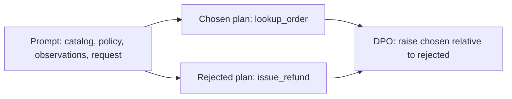
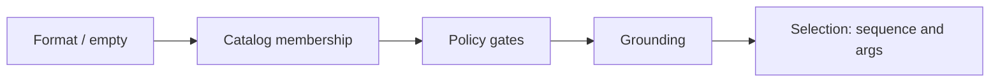
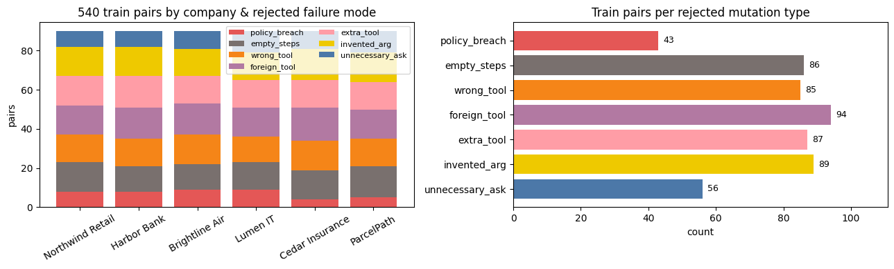
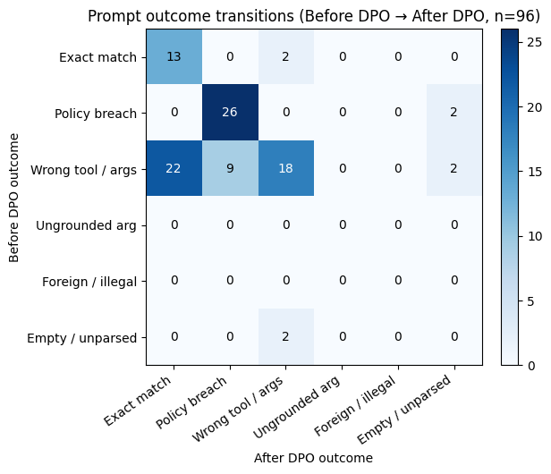
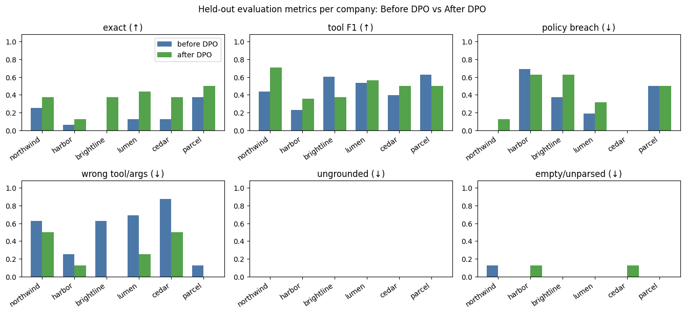
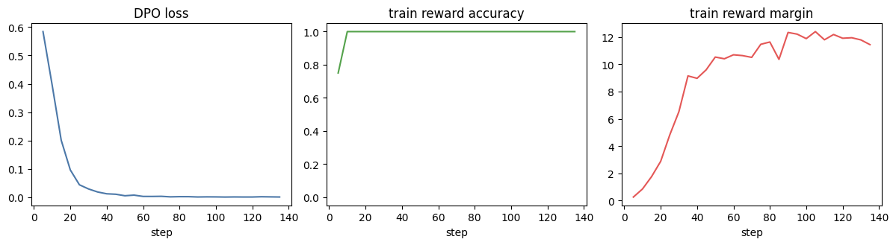
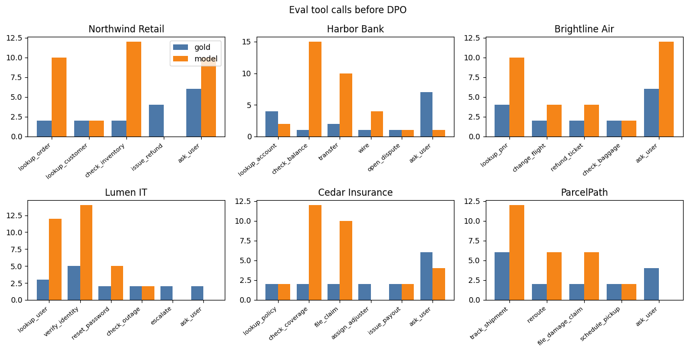
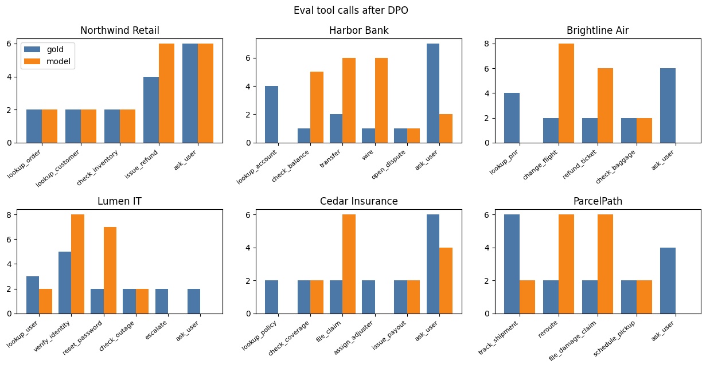

# How DPO teaches an agent which plan to write

## Why planning breaks before tools run

In a production agent, the **planning stage** sits between the user request and tool execution. The model reads the enterprise catalog, policy rules, and current observations, then outputs one structured plan (`{goal, steps, stop_when}`) without calling tools.

General-purpose instruction-tuned LLMs want to be helpful in a single turn. In that slot they produce two failure modes that show up immediately in greedy eval:
- **Wasteful work (`wrong_seq` — 53% of 96 held-out prompts before tuning):** redundant lookups, `check_coverage` and `file_claim` before `lookup_policy`, `lookup_order` paired with `check_inventory`, or `ask_user` before `lookup_pnr` when the id is already available.
- **Premature execution (`policy` — 29% before tuning):** with empty observations, the model fires `issue_refund`, `transfer`, `change_flight`, or `reset_password`, or chains lookup and gated action in one plan before the lookup result exists.

Supervised finetuning increases gold-plan likelihood; it never shows the model the specific wasteful near-miss it is tempted to write on that exact prompt and pushes that string down.

## What DPO is doing here

Direct Preference Optimization skips a separate reward model and online RL rollouts (PPO/GRPO). A closed-form link between an optimal policy $\pi_\theta$ and a frozen reference $\pi_{\mathrm{ref}}$ turns preference data into supervised binary cross-entropy on triples $(x, y^+, y^-)$: prompt $x$, chosen legal plan $y^+$, rejected near-miss $y^-$.

The tools never run in training—you show the same prompt twice and raise $y^+$ relative to $y^-$. The rest of this post is one Colab run on six fictional companies: where that update made held-out plans more exact, and where the pair mix left policy gates untouched.

## What you are asking the model to prefer

A plan in this lab is one JSON object:

```json
{
  "goal": "Look up order A110 before any refund",
  "steps": [
    {"tool": "lookup_order", "args": {"order_id": "A110"}, "because": "status and total are not in the observations"}
  ],
  "stop_when": "Stop after the lookup. Do not refund until the policy evidence is in the observations."
}
```

The user said "Refund order A110. Reason: arrived broken." and the observations were empty. The legal next step is `lookup_order`. A nearby plan calls `issue_refund` immediately. Both are fluent JSON. Supervised finetuning on the lookup raises that string. It does not tell the model that the refund, on this same prompt, is the plan to avoid. A preference pair does.

DPO takes a prompt \(x\), a chosen plan \(y^+\), and a rejected plan \(y^-\). A frozen copy of the model is the reference policy \(\pi_{\mathrm{ref}}\). The trainable policy is \(\pi_\theta\), here a LoRA adapter on `Qwen/Qwen2.5-1.5B-Instruct` with the base weights frozen (`ref_model=None` in TRL, so the reference is the same model with the adapter off). The loss is a binary classification on which plan should score higher:

\[
\mathcal{L}_{\text{DPO}}(\theta) = -\log \sigma\left(\beta\left[\log\frac{\pi_\theta(y^+|x)}{\pi_{\mathrm{ref}}(y^+|x)} - \log\frac{\pi_\theta(y^-|x)}{\pi_{\mathrm{ref}}(y^-|x)}\right]\right)
\]

Read the bracket as an implicit reward margin. \(\beta \log \pi_\theta(y|x) / \pi_{\mathrm{ref}}(y|x)\) is how much more likely this plan became compared with the reference. The sigmoid loss pushes that quantity up for \(y^+\) and down for \(y^-\). \(\beta\) sets how hard the model is pulled away from the reference. This run uses \(\beta = 0.1\), the sigmoid loss, learning rate `5e-5`, and two epochs.

The gradient lands on tokens where the two plans differ. Shared prefix tokens cancel in the log-prob difference, so they are not what gets trained. That is useful for planning. Two plans for the same refund usually share the goal and the JSON keys. The difference is the tool name, the arguments, or whether a gated tool appears at all. DPO spends its update there.



## LoRA connector and one-GPU training

LoRA ($r=16$, $\alpha=32$, dropout 0.05 on `q/k/v/o_proj`) updates **4,358,144** of **1,548,072,448** base weights (**0.2815%**) on `Qwen/Qwen2.5-1.5B-Instruct`. With **`ref_model=None`** in TRL, $\pi_{\mathrm{ref}}$ is the same weights with the adapter disabled—no second 1.5B copy in VRAM. **540** preference pairs, **2** epochs, **136** steps, **997** seconds on a Colab **T4 (14.6 GiB)** in native **`float16`**.

Because the adapter is small and each company's tool catalog lives in the prompt, one frozen base plus one connector can plan across all six domains in this lab without hosting six full models.

## Where the pairs come from

You can build those pairs without asking a person to rank every plan, if you have a checker that knows a legal plan from a near miss. This checker labels a plan by the first rule it breaks:



Catalog: the tool belongs to this company. Policy: a gated action is allowed only when the observations already contain the evidence. A Northwind refund needs a delivered or returned order with `total_usd` <= 50. A Harbor transfer needs a balance that covers an amount <= 1000. A Brightline change needs a changeable fare. A Lumen reset needs a verified employee. A Cedar payout needs confirmed coverage. A Parcel reroute needs a shipment still in transit. Grounding: every id, email, amount, and code in the arguments already appears in the prompt. The `because` text is not checked. Selection: the tool sequence and arguments match the legal next step.

A shorter illegal plan loses. Two legal plans are not a pair. Each training row is one prompt, the legal plan, and one mutation of it: the wrong in-catalog tool, a tool from another company, an extra tool, an invented argument, an unnecessary question, a policy breach, or an empty step list. The row is kept only when the checker accepts the chosen plan and rejects the other for that exact reason.

Six companies share one adapter. The catalog and the policy are in the prompt, so the model is not memorizing a single tool list. Northwind Retail, Harbor Bank, Brightline Air, Lumen IT, Cedar Insurance, and ParcelPath. `enterprise_pairs.jsonl` has 636 rows: 540 train, 96 eval, 90 and 16 per company. Eval ids such as `Z910`, `ACCT-910`, and `PNR-910` do not appear in train. The rejected-plan mix on the 540 is `foreign_tool` 94, `invented_arg` 89, `extra_tool` 87, `empty_steps` 86, `wrong_tool` 85, `unnecessary_ask` 56, `policy_breach` 43.



That mix is the curriculum. Most pairs say "write this tool, not that tool." Fewer pairs say "do not fire the gated action until the lookup is in the observations." DPO will get better at whichever comparison you actually wrote down.

## What got better

Same 96 held-out prompts, greedy decoding, 180 new tokens, before the adapter and after it. A plan is an exact match when the tool names and the arguments match the legal plan.

Before DPO (n=16 per company):

| company | n | exact | f1 | policy | wrong_seq | unground | illegal | empty |
|---------|---|-------|-----|--------|-----------|----------|---------|-------|
| northwind | 16 | 0.25 | 0.44 | 0.00 | 0.62 | 0.00 | 0.12 | 0.12 |
| harbor | 16 | 0.06 | 0.23 | 0.69 | 0.25 | 0.00 | 0.00 | 0.00 |
| brightline | 16 | 0.00 | 0.60 | 0.38 | 0.62 | 0.00 | 0.00 | 0.00 |
| lumen | 16 | 0.12 | 0.53 | 0.19 | 0.69 | 0.00 | 0.00 | 0.00 |
| cedar | 16 | 0.12 | 0.40 | 0.00 | 0.88 | 0.00 | 0.00 | 0.00 |
| parcel | 16 | 0.38 | 0.62 | 0.50 | 0.12 | 0.00 | 0.00 | 0.00 |
| OVERALL | 96 | 0.16 | 0.47 | 0.29 | 0.53 | 0.00 | 0.02 | 0.02 |

After DPO:

| company | n | exact | f1 | policy | wrong_seq | unground | illegal | empty |
|---------|---|-------|-----|--------|-----------|----------|---------|-------|
| northwind | 16 | 0.38 | 0.71 | 0.12 | 0.50 | 0.00 | 0.00 | 0.00 |
| harbor | 16 | 0.12 | 0.35 | 0.62 | 0.12 | 0.00 | 0.12 | 0.12 |
| brightline | 16 | 0.38 | 0.38 | 0.62 | 0.00 | 0.00 | 0.00 | 0.00 |
| lumen | 16 | 0.44 | 0.56 | 0.31 | 0.25 | 0.00 | 0.00 | 0.00 |
| cedar | 16 | 0.38 | 0.50 | 0.00 | 0.50 | 0.00 | 0.12 | 0.12 |
| parcel | 16 | 0.50 | 0.50 | 0.50 | 0.00 | 0.00 | 0.00 | 0.00 |
| OVERALL | 96 | 0.36 | 0.50 | 0.36 | 0.23 | 0.00 | 0.04 | 0.04 |

Exact match went from 15 of 96 prompts to 35 of 96. Wrong tool or arguments went from 51 to 22. Exact match rose at every company. Brightline went from 0 of 16 to 6 of 16. Lumen went from 2 to 7. Parcel went from 6 to 8. Tool-name F1 only moved from 0.47 to 0.50, because the base model was already overlapping the gold tool set on a lot of prompts. DPO cleaned up the sequence more than it discovered the catalog.

The transition matrix is the planning result. Rows are the outcome before DPO, columns the outcome after, on the same 96 prompts.



Of the 51 wrong-tool prompts, 22 became an exact match. Thirteen prompts that were already exact stayed exact. That is the whole exact-match gain: 13 + 22 = 35. Ungrounded arguments stayed at zero. The model got better at writing the step the checker calls legal, on prompts it had been getting wrong.



Training itself was uneventful. 136 steps, 997 seconds, on a T4 in float16. Train loss 0.0524. Eval reward accuracy on the written pairs was 1.000 after both epochs, and the margin was 11.417 then 12.149. Loss was near zero by step 40, and reward accuracy was already 1.0 by about step 10.



Reward accuracy answers a narrower question than the tables above. Given the two finished strings in a pair, did the chosen plan get the higher implicit reward? By step 10 the answer was yes on every logged batch. The tables are a different measurement: sample a new plan, greedily, and run the checker. Both numbers are worth keeping. They move on different schedules.

## What the pairs did not teach

Policy breaches went from 28 of 96 to 35 of 96. Twenty-six of the original 28 stayed policy breaches. Zero of them became exact. Nine prompts that used to be a wrong in-catalog tool became a policy breach instead. The model learned a more specific tool name, and sometimes that name was the gated action.

Brightline is the clearest company. Exact match rose from 0.00 to 0.38 and wrong sequence fell from 0.62 to 0.00, while policy breaches rose from 0.38 to 0.62 and tool F1 fell from 0.60 to 0.38. Before training, a typical miss mixed `lookup_pnr` with other tools, so the set overlap looked decent and the sequence was still wrong. After training, the miss is often `change_flight` or `refund_ticket` alone. On the tool-count chart, Brightline `change_flight` is about 8 calls against a gold count of 2, `refund_ticket` about 6 against 2, and `lookup_pnr` about 0 against 4. Harbor shows the same shape: `lookup_account` about 0 against 4, `transfer` about 6 against 2, `wire` about 6 against 1.





One held-out prompt makes the mechanism concrete. "Change PNR-910 to flight FL-91," observations empty. The legal plan is `lookup_pnr`, because a change is allowed only once the observations say the fare is changeable. Before DPO the model wrote `ask_user` and then `lookup_pnr`. After DPO it wrote `change_flight` and filled `because` with "fare_rule is changeable." The observations did not say that. The pair set contains 43 policy breaches and 94 foreign-tool rejections. The update had much more practice telling catalog tools apart than telling a legal lookup apart from the action it is supposed to gate.

That is the practical lesson for agent training. DPO will make the planner prefer the plans you put on the chosen side of the pairs you actually have. If those pairs are mostly "this tool name, not that tool name," exact match goes up. If you also need "look up, then act," that comparison has to be a large part of the data, not the 43-row slice.

## Edge case: a pair that never trains the first step

Empty plans are not the result of this run. Before DPO, 2 of 96 prompts were empty or unparsed. After DPO, 4 of 96 were. The planning change is in the tool sequence.

They are worth one warning, because it is easy to build a pair file where DPO never sees them as a decision. If the chosen plan and the rejected plan both open `steps` with a tool object, the tokens up through that opening are identical. They cancel. The model gets no gradient on whether to start a step. It only gets a gradient on the tool name inside the step.

An earlier draft of these pairs made that worse. On the prompts where the legal behavior was "do nothing," the chosen plan was empty and the rejected plan opened a step. Those were the only rows that differed at the start of `steps`, so the update pushed toward an empty list. Generations stayed empty before and after, and reward accuracy on the written strings still reached 1.0. The prompt had also said that steps may be an empty list, and it had not shown a step.

The fix is ordinary pair design. Every chosen plan in this file has at least one step. `empty_steps` is a rejected plan (86 of the 540), so an empty list is something the model is asked to rank below a real step. The prompt shows one step. After that change the base model already calls tools, which is the Before table: exact match 0.16, empty 0.02. DPO then has a real planning error to work on.

If your agent sometimes should stop with no call, keep those as their own pairs, with the empty plan on the chosen side only for that prompt, and make sure other pairs put a real step on the chosen side. Otherwise the empty plan becomes the only place the opening of `steps` receives a gradient.

## What to take into a real agent

Write the plan format down, and put the catalog in the prompt if one model serves many tools. Define the order of failure — unknown tool, policy, ungrounded argument, wrong sequence — and build each pair so the rejected plan fails exactly one of those. Train with the base model as the reference. Then generate on prompts whose ids were not in the pairs, and score those generations with the same checker.

On this run that procedure raised exact plans from 15 to 35 out of 96 and cut wrong-tool plans from 51 to 22. It also raised policy breaches from 28 to 35, which the pair counts predicted. The notebook, the pairs, and the charts are in the repo. The next improvement is a larger share of pairs whose rejected plan is the gated action, not a different metric on the same 43.
